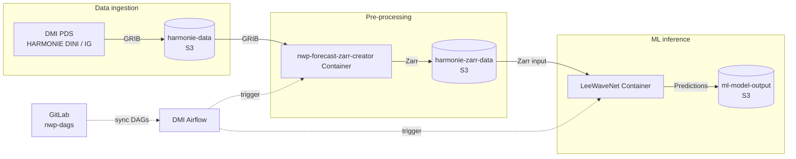

# MLWP Inference Container – LeeWaveNet

`mlwp-inference-container-leewavenet` packages the LeeWaveNet inference
code as a container image for DMI's machine-learning weather prediction
(MLWP) infrastructure.

LeeWaveNet provides deep-learning model for the real-time detection and
characterisation of trapped lee waves.

The model has been adapted to operate on output from the operational
HARMONIE-IG numerical weather prediction model covering the
Iceland-Greenland region.

LeeWaveNet identifies regions containing trapped lee waves and predicts
their main characteristics:

- Lee-wave mask
- Wavelength
- Orientation
- Amplitude

## Operational pipeline

LeeWaveNet is deployed as part of DMI's internal NWP ML infrastructure.

The operational workflow consists of:

1. HARMONIE-IG forecast data is produced by DMI-PDS.
2. The GRIB data is transferred to the internal DMI S3 object store.
3. `nwp-forecast-zarr-creator` converts the required GRIB fields to Zarr.
4. The resulting Zarr dataset is stored in the internal S3 object store.
5. LeeWaveNet reads the Zarr input and performs inference.
6. Predictions are written back to the internal S3 object store.


## Orchestration

The operational pipeline is orchestrated by DMI Airflow.

The Airflow DAGs are maintained separately from the LeeWaveNet inference
code. Airflow triggers the preprocessing and inference components when new
forecast data is available.



Solid arrows represent **data flow**, while dashed arrows represent
**orchestration/control flow**.

## Input data

LeeWaveNet uses HARMONIE-IG forecast data.

The main model input is the vertical velocity field at 700 hPa, converted
from the operational GRIB data into the Zarr representation consumed by
the inference code.

The preprocessing of operational NWP data is handled by
`nwp-forecast-zarr-creator`. LeeWaveNet therefore does not need to handle
the GRIB-to-Zarr conversion itself.

### What the input dataset must contain

The input is a Zarr store that xarray can open. It must have the
following contents.

**Data variable**

| Name | Dimensions | Units | Description |
|---|---|---|---|
| `tw` | `(time, pressure, y, x)` | m s⁻¹ | The field used as vertical velocity |

LeeWaveNet renames `tw` to `wz` when it reads the data. Other variables in
the store are ignored.

**Coordinates**

| Name | Dimensions | Description |
|---|---|---|
| `time` | `(time)` | Forecast times. Every one of them is processed |
| `pressure` | `(pressure)` | Pressure levels in hPa |
| `y`, `x` | `(y)`, `(x)` | Projected grid coordinates in metres |
| `lat`, `lon` | `(y, x)` | Latitude and longitude of every grid point, in degrees |

## Model outputs

For each inference run, LeeWaveNet generates fields describing the
detected trapped lee waves.

The outputs include:

| Output | Description |
|---|---|
| `wave_mask` | Regions where trapped lee waves are detected |
| `wavelength` | Predicted wavelength of the detected waves |
| `orientation` | Predicted wave orientation |
| `amplitude` | Predicted wave amplitude |

The outputs are written to:

```text
s3://ml-model-output/leewavenet/
```

## Model architecture

LeeWaveNet consists of deep-learning models based on the U-Net
architecture.

The segmentation model detects regions containing trapped lee waves from
the 700 hPa vertical velocity field. Additional models are used to
characterise the detected waves:

- **SEGMODEL** – lee-wave detection
- **WLMODEL** – wavelength
- **ORIENTMODEL** – orientation
- **AMPMODEL** – amplitude

## Repository responsibilities

This repository contains the code required for model inference,
including:

- LeeWaveNet inference code
- Input preprocessing required by the model
- Model loading
- Output generation
- Container definition
- Runtime configuration

Infrastructure-specific orchestration is maintained outside this
repository.

In particular:

- **Airflow DAGs** are maintained in `nwp-dags`.
- **GRIB → Zarr conversion** is handled by `nwp-forecast-zarr-creator`.
- **Operational input and output data** are stored in DMI's internal S3
  object storage.

## Usage

To run LeeWaveNet you need three things:

- The model files
- HARMONIE-IG input data in Zarr format
- A place to read the data from, and a place to write the results to

You choose those two places with `--source` and `--destination`. Each one
can be a path on your computer or an S3 address starting with `s3://`.

If you leave them out, LeeWaveNet uses
`storage/ig-recent/pressure_levels.zarr` for the input and
`storage/output` for the output.

You can also set them with the environment variables `LEEWAVENET_SOURCE`
and `LEEWAVENET_DESTINATION`. This is how Airflow runs the container.

### Command line

Install the package and everything it needs:

```bash
uv sync
```

If you want plots, run `uv sync --extra plot` instead. This adds `cartopy`
and `matplotlib`, which are only used for plotting.

Download the models into `storage/models/`:

```bash
uv run python scripts/download_models.py
```

Now run the model on data stored on your computer:

```bash
uv run leewavenet \
  --source storage/ig-recent/pressure_levels.zarr \
  --destination storage/output
```

Add `--plot` to save the segmentation and characteristics plots next to
the results.

To read and write S3 instead, use `s3://` addresses:

```bash
uv run leewavenet \
  --source s3://harmonie-zarr-data/ig-recent/pressure_levels.zarr \
  --destination s3://ml-model-output/leewavenet
```

### Container

LeeWaveNet also runs as a container. Build the image first:

```bash
podman build -t leewavenet .
```

The models are downloaded while the image is built, so you only have to
give it the input and output locations when you run it.

To read and write S3, pass the locations and your S3 keys as environment
variables:

```bash
podman run --rm \
  -e LEEWAVENET_SOURCE=s3://harmonie-zarr-data/ig-recent/pressure_levels.zarr \
  -e LEEWAVENET_DESTINATION=s3://ml-model-output/leewavenet \
  -e AWS_ACCESS_KEY_ID -e AWS_SECRET_ACCESS_KEY -e AWS_ENDPOINT_URL \
  leewavenet
```

To use data on your computer, share the folders with the container using
`-v`. Each `-v` says which folder on your computer becomes which folder
inside the container:

```bash
podman run --rm \
  -v "$PWD/storage/ig-recent:/data:ro" \
  -v "$PWD/storage/output:/out" \
  leewavenet \
  --source /data/pressure_levels.zarr \
  --destination /out
```

Here the input folder is shared as `/data` (read-only) and the output
folder as `/out`, so the results appear in `storage/output` on your
computer.

Do not share a folder as `/project/storage`. The models live in
`/project/storage/models` inside the image, and sharing that folder would
hide them.

To use the GPU, add `--device nvidia.com/gpu=all`. LeeWaveNet uses the GPU
when there is one and the CPU otherwise; the log says which.

### Publishing to ghcr.io

Test the image locally first. When it works, publish it to the GitHub
Container Registry so it can be deployed to the development environment.

The image lives at:

```text
ghcr.io/dmidk/mlwp-inference-container-leewavenet
```

Log in once with a GitHub personal access token that has the
`write:packages` scope:

```bash
echo "$GHCR_TOKEN" | podman login ghcr.io -u <github-username> --password-stdin
```

Build the image with the registry name, tagging it with both the version
and `latest`:

```bash
podman build \
  -t ghcr.io/dmidk/mlwp-inference-container-leewavenet:0.1.0 \
  -t ghcr.io/dmidk/mlwp-inference-container-leewavenet:latest \
  .
```

Push both tags:

```bash
podman push ghcr.io/dmidk/mlwp-inference-container-leewavenet:0.1.0
podman push ghcr.io/dmidk/mlwp-inference-container-leewavenet:latest
```

The version tag should match the version in `pyproject.toml`, so a
deployed image can always be traced back to the code it was built from.

Anyone can then pull and run the published image:

```bash
podman pull ghcr.io/dmidk/mlwp-inference-container-leewavenet:latest
```

A new package is private by default. The first time you push, make the
package public (or grant access to the right team) under the package
settings on GitHub, otherwise pulling requires a token.
